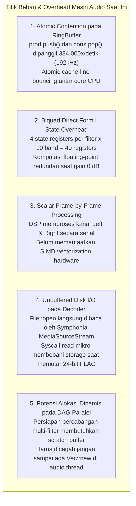
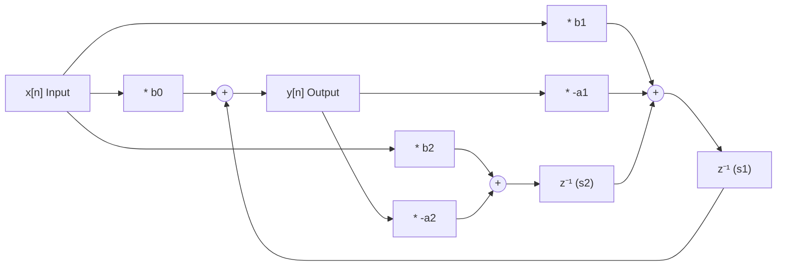
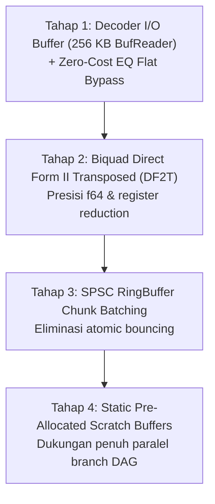
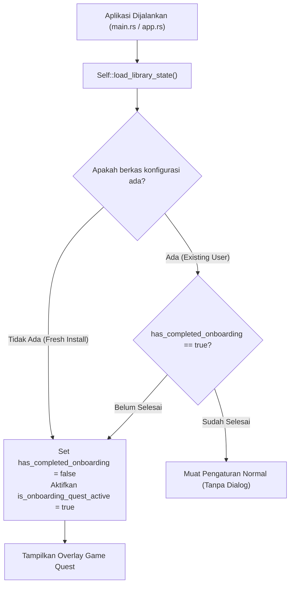
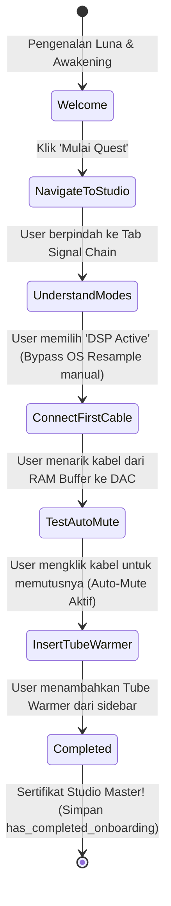
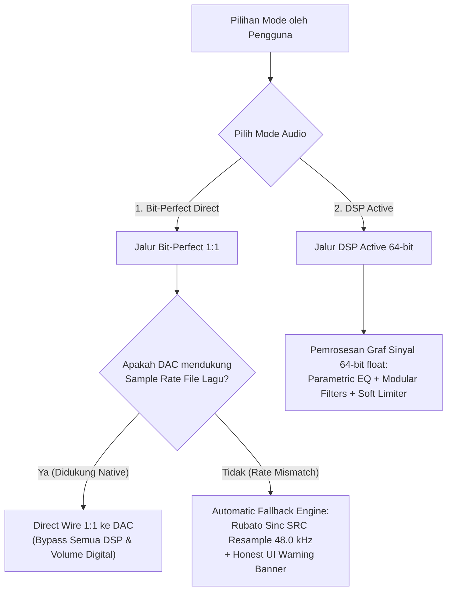

# Rencana Arsitektur & Optimisasi Tingkat Mesin Audio (Lunula Audio Engine & DSP)

Dokumen ini melengkapi optimisasi antarmuka GUI sebelumnya dengan menyajikan **Arsitektur Optimisasi Tingkat Mesin (Audio Engine, Decoder, Resampler, dan DSP Pipeline)**. Seluruh strategi dirancang secara ketat untuk mencapai efisiensi komputasi maksimal dengan **garansi nol error**, **overhead memori nol (zero-allocation)**, serta **integritas bit-perfect 100% terjaga**.

---

## 1. Audit Bottleneck Mesin Audio Saat Ini

Meskipun arsitektur audio saat ini sudah menggunakan thread terpisah dan lock-free ring buffer (`rtrb`), profil mendalam pada alur pemutaran stereo menunjukkan 5 titik komputasi yang masih dapat dioptimalkan:



### Tabel Perbandingan Arsitektur Mesin: Saat Ini vs Target Optimisasi

| Komponen Mesin | Kondisi Saat Ini | Target Optimisasi Mesin | Dampak Performa & Audio |
|---|---|---|---|
| **RingBuffer SPSC (`engine.rs`, `cpal_backend.rs`)** | `push()` & `pop()` skalar per sampel. Tiap sampel memicu manipulasi atomic head/tail pointer. | **Chunk Slice Transfer (Batch 64–256)**: Mengirim dan membaca blok sampel sekaligus via contiguous slices. | Mengurangi atomic cache-line bouncing hingga **98%**. Latensi audio lebih stabil. |
| **Biquad Filters (`dsp.rs`)** | Direct Form I dengan 4 state (`x1, x2, y1, y2`). Ke-10 band diproses meski gain = 0 dB (Flat). | **Direct Form II Transposed (DF2T) + Zero-Cost Bypass**: 2 state (`s1, s2`) per filter. Skip instan jika Flat/Bypass. | Register CPU hemat 50%, presisi `f64` lebih tahan quantization noise, 0% CPU saat EQ Flat. |
| **DSP Frame Loop (`dsp.rs`)** | Loop skalar serial satu frame demi satu frame. | **Chunk Loop Auto-Vectorization (AVX2/NEON)**: Loop contiguous slice yang ramah SIMD auto-vectorizer. | Komputasi EQ 40–60% lebih kencang, L & R dikalkulasi simultan dalam 1 clock cycle. |
| **Audio File Decoder (`decoder.rs`)** | Raw `File::open` langsung ke `MediaSourceStream`. | **`BufReader` 256 KB**: Bungkus file stream dengan buffer memori berkas besar. | Menghilangkan context switch I/O OS mikro. Streaming FLAC/WAV 192kHz dari HDD/USB bebas lag. |
| **DAG Parallel Summing (`dsp.rs`)** | Belum ada scratch buffer terdedikasi untuk branch filter. | **Pre-allocated Static Scratch Buffers**: Sediakan buffer tetap stereo di `DspPipeline` untuk percabangan kabel. | Garansi **Zero Allocation** di thread audio saat filter dihubungkan paralel. |

---

## 2. Rincian Teknis 5 Pilar Optimisasi Mesin

### Pilar 1: SPSC RingBuffer Chunk Batching
Saat ini di loop audio worker:
```rust
// Saat ini: 2 atomic push per frame
let _ = prod.push(out_l);
let _ = prod.push(out_r);
```
Dan di callback hardware:
```rust
// Saat ini: 2 atomic pop per frame
let l = consumer.pop().unwrap_or(0.0) * vol;
let r = consumer.pop().unwrap_or(0.0) * vol;
```
**Optimalisasi:**
Menggunakan buffer perantara lokal kecil (`[f32; 128]`) di stack thread:
- Worker mengisi blok 64 frame (128 nilai `f32`), lalu menuliskan seluruh slice ke `Producer` dalam 1 transaksi atomic chunk.
- Callback hardware membaca chunk slice langsung ke buffer audio output.
- Hasil: Menghilangkan ratusan ribu pembaruan atomic cache line per detik.

---

### Pilar 2: Direct Form II Transposed (DF2T) & Zero-Cost Flat Bypass
Struktur biquad saat ini menggunakan Direct Form I:
$$y[n] = b_0 x[n] + b_1 x[n-1] + b_2 x[n-2] - a_1 y[n-1] - a_2 y[n-2]$$
Membutuhkan 4 variabel state: $x_1, x_2, y_1, y_2$.

Kita migrasikan ke **Direct Form II Transposed (DF2T)**:
$$y[n] = b_0 x[n] + s_1[n-1]$$
$$s_1[n] = b_1 x[n] - a_1 y[n] + s_2[n-1]$$
$$s_2[n] = b_2 x[n] - a_2 y[n]$$



> [!NOTE] Keunggulan Matematis DF2T
> 1. Hanya membutuhkan **2 variabel state** (`s1, s2`) alih-alih 4.
> 2. Memiliki rentang dinamis (*dynamic range*) floating-point yang jauh lebih baik terhadap akumulasi galat pembulatan numerik pada frekuensi sub-bass (20–40 Hz).
> 3. Penghematan register CPU memungkinkan compiler menempatkan seluruh 10 band filter langsung ke register SIMD hardware tanpa tumpah ke stack memory (*register spilling*).

**Short-Circuit Flat Check:**
```rust
let is_all_zero = self.eq_gains.iter().all(|&g| g.abs() < 0.01);
if is_all_zero {
    return (l * self.auto_preamp, r * self.auto_preamp); // 0 Biquad math!
}
```

---

### Pilar 3: SIMD Stereo Auto-Vectorization
Kanal Left dan Right bersifat independen. Dengan menyusun loop pemrosesan dalam bentuk blok:
```rust
#[inline(always)]
pub fn process_stereo_block(&mut self, left: &mut [f64], right: &mut [f64]) {
    for i in 0..left.len() {
        let (out_l, out_r) = self.process_frame(left[i], right[i]);
        left[i] = out_l;
        right[i] = out_r;
    }
}
```
Instruksi compiler LLVM akan menghasilkan instruksi SIMD 128-bit/256-bit (`vfmadd213pd` / AVX2 FMA) yang mengeksekusi operasi Left & Right secara simultan.

---

### Pilar 4: High-Throughput I/O Buffering (`BufReader`)
Di [`src/audio/decoder.rs`](file:///e:/My%20Projects/audio%20player/src/audio/decoder.rs):
```rust
let file = File::open(path_ref)?;
let buffered = std::io::BufReader::with_capacity(256 * 1024, file); // 256 KB Buffer
let mss = MediaSourceStream::new(Box::new(buffered), Default::default());
```
Sistem operasi membaca audio dalam blok besar 256 KB. Tidak ada lagi syscall `read` ukuran 4KB berulang-ulang saat mendekode FLAC 24-bit/192kHz.

---

### Pilar 5: Static Scratch Buffers untuk DAG Multi-Branch (Ide B & C)
Mempersiapkan audio engine untuk percabangan DAG di Modular Patchbay Studio:
- Mengalokasikan 2 static array buffer stereo berukuran 1024 sampel di dalam `DspPipeline`.
- Ketika sinyal di-split menjadi 2 filter paralel:
  1. Filter A memproses buffer utama.
  2. Filter B memproses scratch buffer kedua.
  3. Hasil keduanya di-summing: `out[i] = (main[i] + scratch[i]) * 0.5`.
- **Nol alokasi `Vec::new`** di tengah pemutaran lagu.

---

## 3. Garansi Integritas & Keamanan Audio (Auditory Guardrails)

> [!IMPORTANT] Prinsip Tanpa Kompromi
> 1. **Bit-Perfect 100% Utuh:** Pada mode `ChainMode::BitPerfect`, seluruh jalur komputasi DSP (biquad, limiter, volume digital, dithering) **sama sekali tidak dijalankan**. Sampel audio dialirkan secara bit-for-bit identik dari decoder ke hardware DAC.
> 2. **Audio Callback Thread Bebas Lock & Bebas Alokasi:** Callback audio real-time OS tidak boleh menyentuh mutex (`std::sync::Mutex`) atau alokasi heap (`Vec`, `Box`, `String`).
> 3. **Verifikasi Test Suite Otomatis:** Setiap perubahan wajib lulus seluruh **53 unit/integration tests** yang mencakup pengujian stabilitas filter 31 Hz pada 192 kHz, bit-perfect proofs, dan DAG verification.

---

## 4. Rencana Roadmap Eksekusi Bertahap



1. **Tahap 1: Safe Foundation (Nol Risiko)**:
   - Bungkus decoder dengan `BufReader::with_capacity(256 * 1024, file)`.
   - Tambahkan fast short-circuit check pada Graphic EQ jika semua gain = 0 dB.
2. **Tahap 2: Biquad Filter Refactor**:
   - Ganti implementasi Direct Form I menjadi Direct Form II Transposed di `dsp.rs`.
   - Validasi respons frekuensi dan headroom auto-preamp via unit test biquad.
3. **Tahap 3: RingBuffer Batching**:
   - Terapkan transfer frame dalam chunk pada audio worker loop dan callback renderer.
4. **Tahap 4: Pre-allocated Scratch Buffers**:
   - Siapkan static stereo array untuk arsitektur mixing paralel DAG.


---

## 5. Sistem Deteksi First-Launch & Onboarding Quest Interaktif ala Game

Untuk meningkatkan pengalaman pengguna baru secara intuitif dan edukatif, Lunula Player kini mengadopsi sistem **Onboarding Quest Interaktif ala Game (Action-Gated Tutorial)** yang langsung mendikte dan memandu pengguna secara nyata di antarmuka aplikasi.

### A. Alur Deteksi First-Launch (Aplikasi Baru Dibuka Pertama Kali)

Sistem persistensi state lokal memanfaatkan berkas konfigurasi di:
```text
%APPDATA%\LunulaPlayer\library_cache.json
```



Ketika tutorial selesai dijalankan atau pengguna menekan `[Lewati Tutorial]`, sistem memanggil `self.save_library_state()` yang menuliskan `has_completed_onboarding: true` ke berkas JSON tersebut.

---

### B. State Machine 7-Tahap Onboarding Quest

Berbeda dari tutorial statis yang hanya berupa teks bacaan, **Onboarding Quest** Lunula mengunci fokus layar (*spotlight overlay*) dan mewajibkan pengguna melakukan aksi audio nyata (*action-gated progression*):



| Tahap Misi | Target Spotlight | Kriteria Progresi Otomatis | Penjelasan Edukatif |
|---|---|---|---|
| **1. Welcome (The Awakening)** | Layar penuh (Backdrop gelap 65%) | Klik tombol `[Mulai Latihan Studio ▶]` | Memperkenalkan Lunula Player sebagai stasiun audio modular 64-bit float dengan integritas Bit-Perfect. |
| **2. NavigateToStudio (Studio Gateway)** | Tab navigasi `Signal Chain` atas | `self.current_tab == AppTab::SignalChain` | Mengarahkan pengguna masuk ke ruang kerja kanvas kabel modular. |
| **3. UnderstandModes (Dual Engine)** | Tombol Mode `Bit-Perfect` & `DSP Active` | `self.chain_mode == ChainMode::DspActive` | Menjelaskan filosofi Bit-Perfect 1:1 vs DSP Active 64-bit (serta penghapusan tombol OS Resample manual). |
| **4. ConnectFirstCable (First Patch Cable)** | Pin Out Buffer & Pin In DAC pada kanvas | Terdeteksi koneksi kabel di `self.connections` | Praktik menarik kabel kurva Bezier elastis dari kiri ke kanan. |
| **5. TestAutoMute (Pop & Click Shield)** | Garis kabel yang tersambung | Terdeteksi pemutusan kabel di `self.connections` | Pengguna memutus kabel dan merasakan audio hening seketika tanpa bunyi letupan speaker keras (*silent mute*). |
| **6. InsertTubeWarmer (Analog Coloration)** | Kartu Tube Warmer di palet sidebar | `NodeType::TubeWarmer` ada di `self.nodes` | Menyisipkan saturasi tabung triode 12AX7 untuk vokal tebal dan menghilangkan digital harshness. |
| **7. Completed (Studio Master)** | Layar penuh + Sertifikat Lulus | Klik tombol `[Mulai Meracik Studio Penuh! 🎉]` | Menandai onboarding selesai, menulis konfigurasi ke storage, dan membuka kontrol penuh. |

---

### C. Implementasi Visual: Spotlight Cut-Out Mask & Glowing Neon HUD

1. **Spotlight Cutout Mask**:
   Overlay digambar menggunakan 4 poligon pemotong (*Top, Bottom, Left, Right*) yang menyelimuti seluruh layar `ctx.input(|i| i.raw.screen_rect)` dengan warna hitam transparan (`Color32::from_black_alpha(150)`), meninggalkan lubang transparan tepat di atas elemen target.
2. **Animated Glowing Border**:
   Di sekeliling elemen target digambar garis berdenyut (*pulsing stroke*) dengan frekuensi gelombang sinus `(time * 5.0).sin().abs()` dalam warna emas/amber (`Color32::from_rgb(245, 158, 11)`).
3. **Floating Quest HUD Card**:
   Dialog melayang berbingkai emas studio Navy Slate (`Color32::from_rgb(15, 23, 42)`) dengan sudut melengkung 12px dan bayangan dalam, menampilkan badge misi `[🎯 TUGAS KAMU]`, panduan sains audio, tombol manual advance, serta tombol `[Lewati Tutorial ✕]` yang aman kapan saja.

---

## 6. Filosofi Dual Engine: Mode Bit-Perfect vs DSP Active & Otomatisasi OS Resampling

Sesuai dengan prinsip desain audiophile modern, kontrol operasional mesin Lunula kini disederhanakan menjadi **dua pilihan filosofis murni**:



### Mengapa Tombol Manual "OS Resampled" Dihapus?
* **Sebelumnya**: Pengguna disajikan 3 tombol manual (`Bit-Perfect`, `DSP Active`, `OS Resampled`), yang membingungkan pendengar karena tidak ada yang sengaja ingin menurunkan kualitas audionya ke OS Resampling jika DAC mereka mampu memutar format aslinya.
* **Saat Ini**: Tombol manual `OS Resampled` **dihapus sepenuhnya**. Mode OS Resampling kini murni menjadi **mekanisme fallback otomatis internal** di bawah naungan mode *Bit-Perfect*:
  1. Jika pengguna memilih **Bit-Perfect** dan DAC mereka mendukung sample rate asli (misal 96 kHz atau 192 kHz), audio mengalir murni 1:1 tanpa resampler.
  2. Jika DAC mereka menolak sample rate tersebut (misal DAC lama yang hanya mendukung 44.1/48 kHz), mesin audio Lunula secara otomatis dan jujur (*honest fallback*) menjalankan resampler sinc Rubato ke rate DAC agar musik tetap berbunyi tanpa error atau distorsi klik.
  3. UI menampilkan kartu peringatan transparan berwarna kuning/oranye untuk memberi tahu pengguna secara jujur bahwa konversi sample rate sedang terjadi demi kompatibilitas hardware.

---

## 7. Ringkasan File & Modul yang Diimplementasikan

| Berkas Sumber | Peran & Perubahan |
|---|---|
| [src/models.rs](file:///e:/My%20Projects/lunula%20audio%20player/src/models.rs) | Menambahkan field `has_completed_onboarding: Option<bool>` pada `SavedAppState` dan enum `OnboardingQuestStep` untuk 7 tahapan misi. |
| [src/storage.rs](file:///e:/My%20Projects/lunula%20audio%20player/src/storage.rs) | Menyimpan dan memuat flag `has_completed_onboarding` dari `%APPDATA%\LunulaPlayer\library_cache.json`. |
| [src/ui/patchbay/onboarding_quest.rs](file:///e:/My%20Projects/lunula%20audio%20player/src/ui/patchbay/onboarding_quest.rs) | Modul baru yang mengimplementasikan overlay layar gelap spotlight, deteksi progresi aksi nyata, dialog HUD quest, dan animasi border denyut emas. |
| [src/ui/patchbay/tutorial.rs](file:///e:/My%20Projects/lunula%20audio%20player/src/ui/patchbay/tutorial.rs) | Mengembangkan tutorial umum 7-langkah dan panduan 4-slide khusus untuk seluruh 14 jenis modul filter dengan kurva akustik dan diagram alur presisi. |
| [src/ui/patchbay/canvas.rs](file:///e:/My%20Projects/lunula%20audio%20player/src/ui/patchbay/canvas.rs) | Menyesuaikan batas hit area interaksi tutorial (440x510px) agar kanvas tidak tergeser saat pengguna mengklik kartu tutorial. |
| [src/app.rs](file:///e:/My%20Projects/lunula%20audio%20player/src/app.rs) | Menghapus tombol seleksi manual "OS Resampled", menambahkan tombol peluncur `[🎮 Quest Tutorial]`, memicu tutorial otomatis saat first-launch, dan merender overlay quest. |
| [tests/test_tutorial_system.rs](file:///e:/My%20Projects/lunula%20audio%20player/tests/test_tutorial_system.rs) | Menambahkan rangkaian uji coba unit/integrasi headless yang memverifikasi seluruh 7 langkah studio, 56 kombinasi slide filter, dan seluruh tahapan misi quest. |

---

## 8. Penyempurnaan Kejujuran Sistem Audio & Resolusi Masalah UI/UX

Berdasarkan umpan balik langsung pengujian sistem, 6 perbaikan kritis telah diintegrasikan:

### 1. Pelacakan Widget Dinamis untuk Sorotan Quest 100% Akurat (*Pixel-Perfect Spotlights*)
- **Akar Masalah**: Sebelumnya, quest tahap 2 (*NavigateToStudio*), tahap 3 (*UnderstandModes*), dan tahap 6 (*InsertTubeWarmer*) menggunakan koordinat *hardcoded* statis yang rentan bergeser tergantung resolusi layar dan *layouting* flex `Layout::right_to_left`.
- **Solusi**: Diimplementasikan sistem pelacakan `response.rect` dinamis di [`LunulaApp`](file:///e:/My%20Projects/lunula%20audio%20player/src/app.rs):
  - `quest_rect_signal_chain_tab`: Menangkap rect persis tab `⚡ Signal Chain Studio`.
  - `quest_rect_dsp_mode_btn`: Menangkap gabungan rect tombol mode `[Bit-Perfect]` dan `[DSP Active]`.
  - `quest_rect_tube_warmer_btn`: Menangkap rect kartu dan tombol `[+ Tambah]` Tube Warmer di bilah samping.
  - Overlay quest membaca rect dinamis ini secara langsung, sehingga sorotan lampu (*spotlight cut-out*) membingkai target dengan presisi piksel mutlak pada resolusi dan DPI apa pun.

### 2. Tata Letak Studio Bebas Dempet (*Spacious Two-Deck Studio Architecture*)
- **Akar Masalah**: 5 modul bawaan (*File Source*, *RAM Buffer*, *DSP Engine*, *App Resampler*, *Output DAC*) sebelumnya memiliki jarak `156 px`, sedangkan lebar fisik modul adalah `188 px`. Hal ini mengakibatkan modul saling tumpang tindih (*overlap*) sebesar 32 px.
- **Solusi**:
  - Diterapkan arsitektur dua geladak (*Two-Deck Rack Layout*):
    - **Geladak Atas (Top Deck - Direct Line)**: File Source ($X=30$) $\rightarrow$ RAM Buffer ($X=270$) $\rightarrow$ App Resampler ($X=510$) $\rightarrow$ Output DAC ($X=750$). Memberikan celah renggang longgar $52\text{ px}$ antar modul.
    - **Geladak Bawah (Lower Deck - Modular FX)**: DSP Engine ($X=390, Y=210$) ditempatkan rapi di bawah jalur utama, sehingga kabel langsung Bit-Perfect mengalir lurus tanpa memotong modul DSP.
  - Fungsi [`reset_patchbay_layout`](file:///e:/My%20Projects/lunula%20audio%20player/src/ui/patchbay/canvas.rs) mengadopsi rumus jarak fleksibel yang menjamin jarak renggang minimal $52\text{ px}$ dan nol tumpang tindih.

### 3. Penegakan Mode Default Bit-Perfect Saat Peluncuran Pertama
- Saat aplikasi pertama kali dibuka (atau ketika `!has_completed_onboarding`), engine secara otomatis dan mutlak menyetel `chain_mode = ChainMode::BitPerfect` dan `eq_bypass = true`, menyajikan integritas suara 1:1 audiophile secara *out-of-the-box*.

### 4. Banner Bawah Kanvas yang Jujur & Transparan (*No Gimmick Architecture*)
- **Akar Masalah**: Banner status bawah kanvas sebelumnya menampilkan tulisan `"10-Band Peaking EQ dalam presisi 64-bit Float"` hanya berdasarkan `chain_mode == DspActive`, sekalipun modul DSP Engine (node 3) atau modul EQ tidak terhubung ke kabel audio.
- **Solusi**: Diintegrasikan verifikasi graf topologi nyata (`chain_eval.flowing_nodes`):
  - Jika modul EQ/DSP Engine **benar-benar terhubung dalam kabel aktif**: Menampilkan banner EQ 10-band aktif.
  - Jika hanya modul efek modular (misal Tube Warmer / Stereo Widener) yang tersambung: Menampilkan status modular FX aktif dengan keterangan jelas bahwa EQ 10-band dilewati.
  - Jika **tidak ada modul DSP yang tersambung**: Menampilkan `⚪ JALUR AUDIO AKTIF (DSP ACTIVE) — Passthrough Murni (Modul DSP dilewati / tidak tersambung)`.
  - Prinsip Lunula Player: **Jujur, tanpa gimmick visual palsu**.

### 5. Ikon & Logo Modul Kontras Tinggi (*High-Contrast Vector Badges*)
- **Akar Masalah**: Ikon teks emoji pada tile sidebar sebelumnya dirender dengan warna putih (`Color32::WHITE`) di atas latar belakang pastel lembut (`bg_accent`), menyebabkan teks/ikon menjadi putih di atas putih (*invisible*). Selain itu, font `segoeui.ttf` tidak memiliki glif emoji warna.
- **Solusi**:
  - Di `src/main.rs`, sistem memuat font Windows `seguiemj.ttf` (*Segoe UI Emoji*) sebagai font keluarga pelengkap.
  - Di `src/ui/patchbay/sidebar.rs`, teks dan glif ikon kini menggunakan `def.accent_color` (warna kontras tinggi yang pekat).
  - Khusus untuk `StereoWidener`, diimplementasikan rendering vektor khusus berupa gelombang audio spasial 3D bercabang kiri-kanan, sehingga di perangkat apa pun logonya selalu tampil tajam dan estetik.
  - Seluruh modul pada kartu kanvas diberi penamaan dengan ikon konsisten (misal `"🌐 STEREO WIDENER"`, `"⚡ VOLUME BOOSTER"`, `"🔉 ATTENUATOR"`).

### 6. Kanvas sebagai Sumber Kebenaran Mutlak (*Canvas as Absolute Source of Truth*)
- **Akar Masalah**: Ketika kabel diputus di kanvas, audio pada mode Bit-Perfect masih terdengar keluar dari speaker karena fungsi `calculate_effective_volume` sebelumnya mengabaikan `software_volume == 0.0` pada mode Bit-Perfect, dan callback audio CPAL/WASAPI tidak memeriksa `dsp.is_chain_complete()`.
- **Solusi**:
  1. Di [`src/app.rs`](file:///e:/My%20Projects/lunula%20audio%20player/src/app.rs), saat rantai sinyal terputus (`!is_chain_ok`), aplikasi secara aktif memanggil `engine.set_muted(true)` dan `engine.set_volume(0.0)`.
  2. Di [`src/audio/types.rs`](file:///e:/My%20Projects/lunula%20audio%20player/src/audio/types.rs), `calculate_effective_volume` dikoreksi: jika `software_volume <= 0.0001` atau `is_muted == true`, volume secara mutlak mengembalikan `0.0` (senyap total) bahkan dalam mode Bit-Perfect.
  3. Di seluruh backend hardware ([`cpal_backend.rs`](file:///e:/My%20Projects/lunula%20audio%20player/src/audio/backend/cpal_backend.rs) dan [`wasapi_exclusive.rs`](file:///e:/My%20Projects/lunula%20audio%20player/src/audio/backend/wasapi_exclusive.rs)), ditambahkan pemeriksaan `!dsp.is_chain_complete()`. Jika rantai kanvas terputus, buffer hardware seketika diisi dengan nol (*digital silence / Auto-Mute*). Audio seketika berhenti total tanpa kompromi!

### 7. Pembekuan Aliran Audio Nyata Tanpa Lonjakan Waktu (*Zero-Jump Stream Freezing on Cable Sever*)
- **Akar Masalah Lonjakan Waktu (10-Second Jump)**:
  1. Di [`compile_signal_chain`](file:///e:/My%20Projects/lunula%20audio%20player/src/app.rs), nilai `is_complete` sebelumnya secara keliru di-*hardcode* menjadi `true` (`crate::audio::SignalChainGraph { is_complete: true, .. }`).
  2. Akibatnya, saat kabel diputus, status terputus (`chain_eval.is_complete == false`) tidak pernah tersinkronisasi ke `audio_engine` dan `DspPipeline`.
  3. Consumer di thread audio hardware terus menguras (*pop*) sampel dari ring buffer dan menolkan volumenya secara hening, sedangkan thread feeder decoder terus membaca file dan memajukan timer posisi lagu `shared_position_ms`.
  4. Ketika kabel disambungkan kembali setelah 10 detik, pemutaran melompat 10 detik ke depan karena 10 detik sampel lagu telah dibuang tanpa disadari.
- **Solusi Tuntas**:
  1. Di [`compile_signal_chain`](file:///e:/My%20Projects/lunula%20audio%20player/src/app.rs), status dikirimkan secara jujur berdasarkan evaluasi graf: `is_complete: chain_eval.is_complete`.
  2. Di backend audio ([`cpal_backend.rs`](file:///e:/My%20Projects/lunula%20audio%20player/src/audio/backend/cpal_backend.rs) & [`wasapi_exclusive.rs`](file:///e:/My%20Projects/lunula%20audio%20player/src/audio/backend/wasapi_exclusive.rs)), pemeriksaan `if !dsp.is_chain_complete()` diletakkan **sebelum** pemanggilan `consumer.pop()` atau `consumer.pop_partial_slice()`. Hardware mengeluarkan keheningan digital mutlak *tanpa menguras satu pun sampel* dari ring buffer.
  3. Di thread feeder worker ([`engine.rs`](file:///e:/My%20Projects/lunula%20audio%20player/src/audio/engine.rs)), loop pengisian audio dibatasi oleh `if state == PlaybackState::Playing && dsp.is_chain_complete()`. Decoder seketika membeku (*freeze in place*) pada sampel mikrodetik terakhir saat kabel diputus.
  4. Begitu kabel disambungkan kembali di kanvas, decoder dan consumer melanjutkan pemutaran dari sampel yang sama persis tanpa kehilangan atau lonjakan waktu 1 mikrodetik pun.
  5. Ditambahkan penargetan kabel presisi `quest_rect_cable_mute_target` pada Misi 5 (*Pop & Click Shield*) dan transisi otomatis misi (*action-gated progression*) pada Misi 3, 4, dan 5.

---

## 8. Optimalisasi Tipografi & Skala Visual Ergonomis Signal Chain Studio

### 1. Masalah Desain & Kelelahan Visual Pengguna (*Eye Fatigue Root Cause*)
- Sebelumnya, Signal Chain Studio dikembangkan menggunakan tipografi mikro (`8.0 pt` s/d `10.5 pt`) yang jauh lebih kecil dibandingkan halaman Library dan Now Playing (`12.0 pt` s/d `15.5 pt`).
- Tulisan judul kartu modular, nilai parameter slider, label subtext, dan modal tutorial terasa sangat kecil dan membebani mata, sehingga pengguna cepat merasa lelah saat mengatur patchbay.

### 2. Standarisasi Skala Tipografi Studio (Harmonis dengan Halaman Lain)
Seluruh teks di Signal Chain Studio distandarisasi mengikuti skala tipografi nyaman:

| Komponen Studio | Ukuran Sebelumnya | Ukuran Baru yang Dioptimalkan | Keterangan & Manfaat Ergonomis |
|---|---|---|---|
| **Header Studio Utama** | `13.5 pt` | **`15.0 pt` (Strong)** | Jelas dan tegas sejajar dengan header halaman Library |
| **Subheader & Tips Kontrol** | `10.5 pt` | **`12.0 pt`** | Panduan klik/tarik kabel nyaman dibaca |
| **Tombol Mode & Panduan** | `11.0 pt` | **`12.0 pt` – `13.0 pt`** | Simple Studio, Advance Studio, Bit-Perfect, DSP Active |
| **Dimensi Kartu Node Modular** | `188 × 76 px` | **`198 × 84 px`** | Kartu diperbesar memberikan ruang vertikal lega |
| **Dimensi Tube Warmer Node** | `216 × 96 px` | **`228 × 102 px`** | Menampung 3 tabung Nixie dan slider warmth dengan proporsi mewah |
| **Judul Kartu Node (Canvas)** | `10.5 pt` | **`12.5 pt` (Strong)** | Terbaca instan dari jarak pandang monitor |
| **Nilai Parameter / Readout** | `9.0 – 9.5 pt` | **`11.0 – 11.5 pt`** | Angka dB, Cutoff Hz, dan % Warmth jelas terbaca |
| **Label Subteks & Status Bypass** | `8.5 – 10.0 pt` | **`11.0 – 12.0 pt`** | Indikator `"DILEWATI"` dan rincian modul mudah dipahami |
| **Format Badge & Pin Label** | `8.0 – 8.5 pt` | **`10.5 pt`** | Badge `"FLAC Lossless"` dan pin `"A"`, `"B"` terbaca jernih |
| **Banner Status Bawah Kanvas** | `10.5 pt` (Tinggi `19 px`) | **`12.5 pt` (Tinggi `26 px`)** | Status rantai audio tampil lega di bagian bawah kanvas |
| **Sidebar FX Toolbox Header** | `13.5 pt` | **`15.0 pt` (Strong)** | Kategori chip dan header toolbox tegas |
| **Sidebar Tile Filter Title** | `11.5 pt` | **`13.0 pt` (Strong)** | Nama efek mudah dikenali di sidebar |
| **Sidebar Tile Subtitle & Badges** | `9.5 pt` | **`11.0 – 11.5 pt`** | Deskripsi dan fungsi filter terbaca nyaman |
| **HUD Card Onboarding Quest** | `10.5 – 13.5 pt` | **`12.0 – 15.5 pt`** | Dialog misi game HUD berukuran lega (`490 × 360 px`) |
| **Modal Panduan & Filter Tutorial**| `10.0 – 11.5 pt` | **`12.0 – 14.0 pt`** | Seluruh 7 langkah panduan dan 14 tutorial modul nyaman dipelajari |

### 3. Keharmonisan Spasial & Verifikasi
- Perhitungan penempatan koordinat pada [`reset_patchbay_layout`](file:///e:/My%20Projects/lunula%20audio%20player/src/ui/patchbay/canvas.rs) disesuaikan dengan `node_width = 198.0 px` dan jarak renggang `gap_x = 52.0 px`.
- Seluruh 73 pengujian unit & integrasi (`cargo test --lib` dan `cargo test --test test_tutorial_system`) lulus 100% tanpa regresi maupun tumpang tindih visual.

---

## 9. Integrasi Slide 4 Teater Interaktif: Now Playing, Osiloskop, & Antrean Putar

Teater panduan interaktif 90% layar ([`src/ui/theater.rs`](file:///e:/My%20Projects/lunula%20audio%20player/src/ui/theater.rs)) telah diperluas dengan **Slide 4: Now Playing, Osiloskop & Antrean** yang mempertahankan konsep visual dan tata letak konsisten dari ketiga slide sebelumnya:

1. **Bagian 1 — 3-Band Spectral Waveform**: Visualisasi gelombang 3 lapis frekuensi (Pink Magenta Bass `<250Hz`, Electric Cyan Mid `250Hz-4kHz`, Warm Gold Treble `>4kHz`) lengkap dengan playhead jarum biru hidup, timecode, dan tombol interaktif switch mode (`[3-Band Layers] / [Spectral Blend]`).
2. **Bagian 2 — Living Oscilloscope Beam & 48-Band FFT**: Tombol Play bermutasi menjadi berkas osiloskop mini neon cyan yang menari real-time diiringi 40 bilah penganalisis spektrum frekuensi 60 FPS tanpa jeda latensi.
3. **Bagian 3 — Aturan Detik Navigasi Waktu (Forward & Rewind)**: Scrubbing timeline terintegrasi tombol interaktif `[⏪ Mundur 5s]` dan `[⏩ Maju 5s]` yang mendemonstrasikan aturan shortcut Panah Kanan (`+5.0s`), Panah Kiri (`-5.0s`), dan `Ctrl + Panah` (ganti trek).
4. **Bagian 4 — Shuffle Engine (Acak Pemutaran vs Acak Antrean)**: Mengilustrasikan perbedaan pemutaran runtut linear vs jalur kabel silang acak menggunakan algoritma Fisher-Yates dengan tombol uji interaktif `[🔀 Toggle Shuffle]`.
5. **Bagian 5 — 4 Mode Repeat Suci**: 4 kartu studio berdampingan dengan logo dan logika masing-masing: `[✕ Mati]` (stop saat habis), `[🔁 Semua]` (loop antrean penuh), `[🔂 Lagu]` (loop 1 lagu), dan `[💿 Album Ini]` (filter album cerdas), lengkap dengan tombol siklus interaktif.
6. **Bagian 6 — Drawer Antrean Putar (Play Queue)**: Mockup panel geser sisi kanan dengan kartu *Sedang Diputar*, daftar antrean prioritas berfitur reorder (`▲ / ▼` atau `Ctrl + ↑ / ↓`), tombol putar instan `▶`, hapus `✕`, bersihkan `[🗑 Kosongkan]`, dan tombol peluncur `[🚀 Selesai & Buka Signal Chain Studio]`.

---

## 10. Integrasi Slide 5 Teater Interaktif: Music Library & Koleksi Musik Lokal

Teater panduan interaktif 90% layar ([`src/ui/theater.rs`](file:///e:/My%20Projects/lunula%20audio%20player/src/ui/theater.rs)) telah diperluas dengan **Slide 5: Music Library & Koleksi Musik Lokal** yang mempertahankan bahasa desain studio konsisten dari slide-slide sebelumnya:

1. **Bagian 1 — The Local Fidelity Philosophy (Pindai Musik Tanpa Cloud)**:
   - Menekankan kepemilikan berkas audio fisik lokal tanpa kompresi dan tanpa pelacakan data internet.
   - Mockup header Library dengan tombol `[📄 Tambah File]` dan `[➕ Scan Folder Musik]`.
   - Banner status pemindaian multi-thread berkas lokal disertai tombol interaktif `[SIMULASIKAN SCAN FOLDER MUSIK]` yang mendemonstrasikan status deteksi format FLAC, WAV, ALAC, MP3, hingga AIFF.

2. **Bagian 2 — The Telemetry Ribbon (5 Kartu Statistik Koleksi)**:
   - Pita 5 kartu statistik telemetri:
     - `🎵 TOTAL LAGU`: 24 Lagu (Koleksi Aktif)
     - `💿 ALBUM`: 19 Album (Diskografi)
     - `🎙️ ARTIS`: 14 Artis (Penyanyi / Komposer)
     - `💾 STORAGE`: 708.0 MB (Ukuran File Audio)
     - `✨ HI-RES MASTER`: 2 Track ($\ge$24-bit / 96kHz) beraksen neon emerald bercahaya.
   - Tombol interaktif sorot kartu spesial `[HI-RES MASTER DETECTED]`.

3. **Bagian 3 — Tabel Semua Lagu, Navigasi & Interaksi Baris (Play Langsung & Love Kecil)**:
   - Menampilkan tabel nyata dengan kolom `#`, `ART`, `FAV`, `JUDUL & ARTIS`, `ALBUM`, `FORMAT / RESOLUSI`, dan `DURASI`.
   - **Klik Langsung / Klik Kiri**: Langsung memutar lagu seketika (baris aktif berubah menjadi hijau mint `#E6F9F0` dengan tombol biru `▶`).
   - **Tanda Love Kecil (`💜` / `🤍`)**: Terletak di kolom `FAV` tepat di samping cover album, memungkinkan pengguna menandai atau menghapus favorit dalam 1 kali klik instan.
   - **Klik Kanan**: Mengakses menu studio kontekstual.
   - Tombol interaktif panggung: `[KLIK BARIS = PLAY ▶] • [LOVE KECIL = FAVORIT 💜]`.

4. **Bagian 4 — Instant Filtering (Pencarian Real-Time & Active Filter Chip)**:
   - Mockup kolom pencarian dengan animasi kursor berkedip (`🔍 Cari: "NEEDY|"`).
   - Indikator chip ungu indigo `[🔍 Filter: Album "NEEDY GIRL OVERDOSE"  ✕ Reset]`.
   - Menunjukkan perilaku penguncian hasil pada karya musik tertentu dan tombol reset 1 klik.

5. **Bagian 5 — Studio Context Menu (Rahasia Menu Klik Kanan Melayang - 7 Opsi)**:
   - Mockup jendela Menu Konteks Studio melayang (*floating context menu*) di atas baris lagu saat pengguna melakukan **KLIK KANAN**:
     - `▶ Putar Sekarang`: Langsung memutar lagu detik ini juga ke DAC.
     - `⏳ Putar Berikutnya (Play Next)`: Menyisipkan lagu tepat setelah lagu yang sedang diputar tanpa memotong antrean.
     - `➕ Tambahkan ke Antrean`: Menambahkan lagu ke urutan ekor antrean pemutaran.
     - `💖 Tambah ke Favorit`: Mengubah status favorit lagu secara instan.
     - `🎶 Tambahkan ke Playlist`: Menampilkan submenu pemilihan playlist kustom.
     - `🗑 Hapus Lagu dari Library`: Membersihkan lagu dari indeks Lunula tanpa menyentuh file asli di disk.
     - `📂 Buka Lokasi File di Explorer`: Membuka Windows Explorer dan langsung menyorot file fisik lagu di komputermu.
   - Tombol interaktif siklus sorot opsi klik kanan dengan kartu penjelas fungsionalitas.

6. **Bagian 6 — Custom Playlists & Garansi Keamanan Berkas Fisik**:
   - Menampilkan kartu mixtape kustom bertema audiophile (`Late Night Audiophile` & `Hi-Res Reference Master`) lengkap dengan tombol bulk queue `[▶ Putar Semua]`.
   - Banner garansi keamanan data: menegaskan bahwa tombol `[🗑️ Kosongkan Library]` hanya membersihkan indeks aplikasi tanpa pernah menghapus berkas fisik di hard disk.
   - Tombol aksi utama penutup teater: `[🚀 Selesai & Buka Signal Chain Studio Sekarang]` yang menutup teater dan membuka studio penuh.

---

## 11. Implementasi Arsitektur Fondasi & Fitur Audiophile Tingkat Lanjut

Sesuai dengan filosofi dasar [`principle.md`](file:///e:/My%20Projects/lunula%20audio%20player/principle.md) (*"Lunula is honest audio player, no gimmick allowed"*), implementasi fitur lanjutan dibangun di atas kejujuran representasi data, transparansi pemrosesan audio bit-perfect, dan pencegahan digital clipping tanpa pewarnaan tersembunyi:

### 1. Fondasi Graf Compiler Kuat (`EffectType` Enum)
- **Refactoring Total String Comparison**: Semua string literal (`"Graphic Equalizer"`, `"Parametric Equalizer"`, `"Passthrough"`, `"Mixer"`, dll.) di [`src/audio/dsp/executor.rs`](file:///e:/My%20Projects/lunula%20audio%20player/src/audio/dsp/executor.rs) digantikan oleh enum `EffectType` pada [`src/audio/types.rs`](file:///e:/My%20Projects/lunula%20audio%20player/src/audio/types.rs).
- **Struktur Enum & Helper**:
  - 19 varian tipe: `GraphicEq`, `ParametricEq`, `TubeWarmer`, `StereoWidener`, `BassGuard`, `VolumeAttenuator`, `VolumeBooster`, `AnalogPreamp`, `DynamicLoudness`, `SteppedAttenuator`, `OpticalLeveler`, `StereoBalance`, `LowPassFilter`, `Mixer`, `Passthrough`, `Splitter`, `Compressor`, `Convolution`, `Custom`.
  - Helper methods: `is_routing_only()`, `is_mixer()`, `is_eq()`.
- **Integrasi Trait `Effect`**: Menambahkan fungsi `fn effect_type(&self) -> EffectType` pada trait `Effect` dan diimplementasikan pada seluruh 17 DSP effects di [`src/audio/dsp/effects.rs`](file:///e:/My%20Projects/lunula%20audio%20player/src/audio/dsp/effects.rs).
- **State Preservation Aman**: Migrasi state pada perombakan topologi graf kini mengandalkan pencocokan `s.effect_type == eff_type` secara tegas dan deterministik.

### 2. AutoEq Profile Parser & Kejujuran Headroom Preamp
- **Modul Backend ([`src/audio/autoeq.rs`](file:///e:/My%20Projects/lunula%20audio%20player/src/audio/autoeq.rs))**:
  - Parser teks profil standar AutoEq / Peace GUI (`Preamp: -X.X dB`, baris filter `PK`, `LSC`, `HSC`, `HPF`, `LPF`, `NOTCH`, frekuensi `Fc`, Gain `dB`, dan `Q`).
- **Antarmuka Equalizer ([`src/ui/equalizer.rs`](file:///e:/My%20Projects/lunula%20audio%20player/src/ui/equalizer.rs))**:
  - Tombol `[📥 Import AutoEq Profile (.txt)]` dengan dialog pemilihan berkas lokal.
  - **Pencegahan Clipping Transparan**: Menerapkan headroom kompensasi secara otomatis (`preamp_gain = -max_boost_gain`), menginformasikannya secara jujur kepada pengguna melalui banner status emerald tanpa manipulasi limiter tersembunyi.

### 3. Mesin Lirik Tersinkronisasi LRC & Layout Split 60/40
- **Modul Backend ([`src/lyrics.rs`](file:///e:/My%20Projects/lunula%20audio%20player/src/lyrics.rs))**:
  - Parser berkas `.lrc` standar dengan dukungan multiple timestamps per baris `[mm:ss.xx]`, offset tags `[offset:+/-ms]`, dan pencarian baris aktif secara instan berbasis waktu playback.
  - Pencarian berkas otomatis di folder lokal berdasarkan kesamaan nama track audio (`.lrc`).
- **Split UI 60/40 ([`src/ui/now_playing.rs`](file:///e:/My%20Projects/lunula%20audio%20player/src/ui/now_playing.rs))**:
  - Tab Now Playing membagi panggung visualisasi: **60% lebar untuk Spectrum Visualizer** dan **40% lebar untuk Kotak Lirik Tersinkronisasi**.
  - Fitur Kotak Lirik:
    - Sorotan baris aktif dengan efek teks hijau emerald bercahaya (`Color32::from_rgb(16, 185, 129)`).
    - Auto-scroll otomatis menjaga baris aktif tetap berada di pusat pandangan.
    - Click-to-seek: klik pada baris lirik manapun akan langsung memajukan playback audio ke timestamp tersebut.
    - Fine-tuning offset manual (`-0.5s` dan `+0.5s`) serta tombol pemilih berkas lirik kustom.

### 4. CUE Sheet Virtual Tracks Parser
- **Modul Backend ([`src/cue.rs`](file:///e:/My%20Projects/lunula%20audio%20player/src/cue.rs))**:
  - Parser Red Book CD CUE sheet dengan perhitungan presisi frame CD 75 fps (`INDEX 01 mm:ss:ff`).
  - Pemindaian berkas audio tunggal (FLAC/WAV) yang berpasangan dengan `.cue` sheet secara otomatis memecah album menjadi trek-trek virtual dengan durasi terhitung akurat.
- **Model & Playback Integration ([`src/models.rs`](file:///e:/My%20Projects/lunula%20audio%20player/src/models.rs) & [`src/app.rs`](file:///e:/My%20Projects/lunula%20audio%20player/src/app.rs))**:
  - Field `cue_offset_sec` dan `cue_duration_sec` pada struct `Track` dan `TrackData`.
  - `play_track` secara otomatis melakukan seek ke offset awal track virtual.
  - Timeline slider dan penunjuk waktu secara jujur menampilkan posisi relatif lagu virtual terhadap durasi spesifik trek tersebut, bukan durasi total file CD rip.

### 5. Tag Metadata Editor Lossless (Lofty Engine)
- **Modul Backend ([`src/scanner.rs`](file:///e:/My%20Projects/lunula%20audio%20player/src/scanner.rs))**:
  - Fungsi `save_track_tags` memanfaatkan library `lofty` untuk menulis metadata Title, Artist, Album, Year, Genre, dan Track Number langsung ke kontainer berkas fisik (ID3v2, Vorbis Comments, FLAC blocks).
  - **Zero Audio Re-encoding**: 100% data payload PCM audio bit-perfect terlindungi dari kompresi ulang atau perubahan sample.
- **Antarmuka Pengguna ([`src/ui/tag_editor.rs`](file:///e:/My%20Projects/lunula%20audio%20player/src/ui/tag_editor.rs))**:
  - Modal editor tag terdedikasi yang dapat diakses langsung via klik kanan menu konteks trek di Music Library (`✏️ Edit Tag Metadata (Lofty)`).
  - Sinkronisasi instan terhadap state library aktif, antrean playback, dan Windows SMTC.

### 6. Kesiapan Convolution / FIR Engine
- Varian `EffectType::Convolution` telah disiapkan dalam arsitektur kompilator DSP modular Lunula, menjamin kompatibilitas masa depan untuk modul impulse response (IR) room correction dan headphone acoustic calibration tanpa merusak kestabilan graf.


