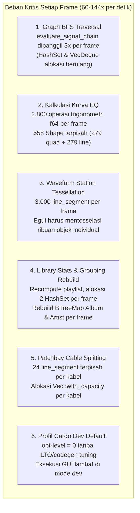
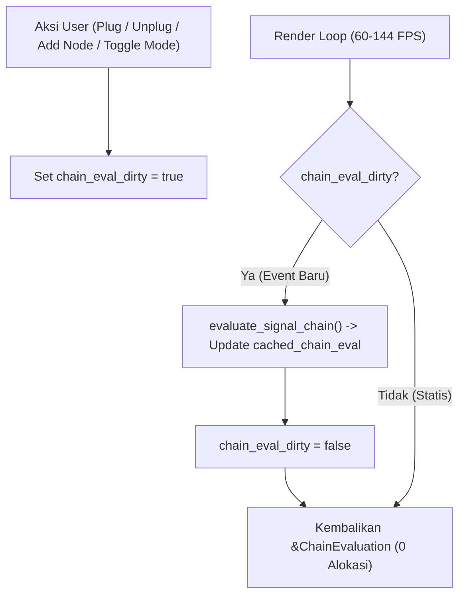

# Rencana Implementasi: Optimisasi Brutal GUI, Memori & Batching GPU (Sebelum Menyentuh Mesin Audio)

Dokumen ini menjabarkan audit performa komprehensif, diagnosis bottleneck kritis pada loop render 60–144 FPS, serta arsitektur **Optimisasi Brutal** pada lapisan antarmuka (GUI), struktur data, dan manajemen memori sebelum melangkah ke tahap implementasi backend audio engine.

---

## 1. Audit Beban & Diagnosis Bottleneck Kritis (Profil 60 FPS)

Berdasarkan audit mendalam terhadap seluruh file UI dan alur runtime aplikasi saat ini, ditemukan 6 titik pemborosan CPU dan heap allocation masif yang terjadi **pada setiap frame render**:



### Tabel Perbandingan: Kondisi Saat Ini vs Target Optimisasi Brutal

| Komponen | Kondisi Saat Ini (Unoptimized) | Target Optimisasi Brutal | Dampak Performa |
|---|---|---|---|
| **DAG Reachability (`app.rs`, `patchbay.rs`, `equalizer.rs`)** | `evaluate_signal_chain()` dipanggil 3× per frame. Tiap panggilan mengalokasi `HashSet` dan `VecDeque` ganda. | **Cached Topology**: Disimpan di `cached_chain_eval`. Hanya dihitung ulang jika `topology_dirty == true` (kabel dicabut/dipasang, node ditambah/dihapus). | Eliminasi ~180 alokasi heap per detik. 0 overhead saat kanvas diam. |
| **Kurva EQ Parametrik (`equalizer.rs`)** | Menghitung 280 titik $\times$ 10 band = 2.800 fungsi trigonometri (`cos`, `sin`, `log10`) per frame. Mengalokasi 279 `convex_polygon` quad dan 279 `line_segment`. | **Batched GPU Draw Calls & Point Cache**: Menggunakan 1 single `Mesh` untuk area fill dan 1 `Shape::line` untuk garis respons. Cache titik kurva saat statis. | Penurunan dari 558 draw calls menjadi **2 draw calls**. Hemat 99% CPU rendering EQ. |
| **Waveform Station (`now_playing.rs`)** | Loop 500 langkah $\times$ 6 segmen per langkah = **3.000 shape `line_segment`** dikirim ke painter setiap frame. | **Single-Mesh Vertex Batching**: Mengompilasi seluruh bar gelombang multi-band (bass, mid, treble) ke dalam satu `egui::Mesh` berisi quads/triangles. | Penurunan dari 3.000 shapes ke **1 single GPU mesh call**. FPS stabil di 144 Hz tanpa stutter. |
| **Library Agregasi & Grouping (`library.rs`)** | `compute_library_stats` mengiterasi seluruh lagu dan membuat 2 `HashSet` per frame. Tab Album dan Artist mengalokasi `BTreeMap` baru per frame. | **Cached Library Index**: Agregasi stats, list album, dan list artist di-cache di `LunulaApp`. Hanya dibangun ulang saat ada penambahan/penghapusan lagu. | 0 alokasi memori saat scrolling library. Instantaneous tab switching. |
| **Patchbay Cables (`patchbay.rs`)** | Setiap kabel memecah kurva Bezier menjadi 24 `line_segment` terpisah dan 24 segmen bayangan. | **`Shape::line` Vectorized Polyline**: 1 polyline untuk bayangan dan 1 polyline untuk kabel. Titik Bezier di-cache per kabel. | Pengurangan drastis jumlah perintah gambar kanvas. |
| **Kompilasi Cargo (`Cargo.toml`)** | `opt-level = 0` standar debug tanpa optimasi inline atau codegen units. | Tambahkan `[profile.dev]` dengan `opt-level = 1` dan `[profile.release]` dengan `lto = "thin"`, `codegen-units = 1`, `strip = true`. | Kecepatan eksekusi naik 3-5× di dev dan binary release ultra-ringan. |

---

## 2. Rincian Arsitektur Teknis Optimisasi

### A. Graph Topology & DAG Caching


### B. Waveform Multi-Band Single-Mesh Batching
Alih-alih memanggil `painter.line_segment()` ribuan kali:
```rust
// Konstruksi 1 Mesh tunggal untuk semua bar waveform
let mut mesh = egui::Mesh::default();
for bar in bars {
    // Tambahkan 4 vertex dan 2 triangle (6 index) per bar langsung ke GPU buffer
    mesh.add_rect_with_color(bar_rect, color);
}
painter.add(egui::Shape::Mesh(mesh));
```
Pendekatan ini memangkas overhead traversal memori egui painter dari $\mathcal{O}(N)$ objek menjadi satu blok memori contiguous.

### C. EQ Curve Vectorization & Point Invalidation
1. **Cache Validasi**: Titik kurva di-cache dalam `cached_eq_curve: Vec<Pos2>`.
2. **Kondisi Dirty**: Hanya dihitung ulang jika:
   - Band frekuensi/gain/Q berubah.
   - Mode bypass berubah.
   - Ukuran rect kanvas berubah (resize window).
3. **Penyajian GPU**:
   - Area fill bawah kurva: 1 `egui::Mesh` tunggal dengan triangle strip.
   - Garis kurva: 1 `egui::Shape::line(cached_curve, stroke)`.

### D. Library Metadata Indexing
Struktur cache baru di `LunulaApp`:
```rust
pub struct LibraryCache {
    pub stats: (usize, usize, usize, f32, usize),
    pub albums: Vec<AlbumGroup>,
    pub artists: Vec<ArtistGroup>,
    pub is_dirty: bool,
}
```
Ketika user mengimpor folder atau menghapus lagu, `is_dirty` dinyalakan sekali. Selama pemutaran dan navigasi normal, seluruh UI membaca data yang sudah siap tanpa kalkulasi string atau hashing ulang.

---

## 3. Rencana Eksekusi Bertahap

```mermaid
timeline
    title Timeline Optimisasi Brutal GUI
    section Fase 1: Cargo & Graph Caching
      Cargo.toml profile tuning : Prioritas Utama
      Implementasi chain_eval_dirty & caching di app.rs : Prioritas Utama
      Integrasi patchbay & equalizer ke cached evaluation : Prioritas Utama
    section Fase 2: Waveform Single-Mesh
      Refactor render_ambient_waveform_station ke egui::Mesh : Target 2
      Uji performa 144 FPS transport deck : Target 2
    section Fase 3: Equalizer Curve Batching
      Batching 280 points ke 1 Mesh + 1 Shape::line : Target 3
      Caching kalkulasi biquad saat diam : Target 3
    section Fase 4: Library Grouping Caching
      Cache compute_library_stats & BTreeMap grouping : Target 4
      Verifikasi 52+ unit/integration test : Final
```

---

> [!IMPORTANT]
> Seluruh optimisasi ini murni menyasar efisiensi lapisan **GUI, alokasi memori, dan GPU draw call**, tanpa mengubah logika sinyal bit-perfect maupun arsitektur DAG yang telah disepakati. Mesin audio DSP tetap utuh dan siap menerima data dengan overhead nol.

