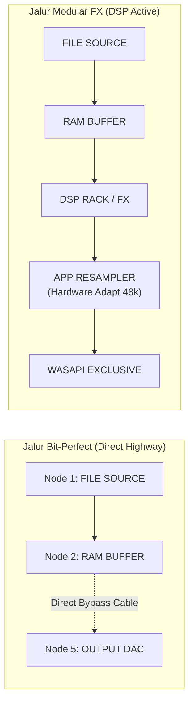

# Roadmap Arsitektur Audio Engine, Real-Time Safety & Modular DSP Studio

Dokumen ini merangkum peta jalan (*roadmap*) rekayasa teknis Lunula Audio Player yang berpedoman mutlak pada [`principle.md`](principle.md): **"Lunula is honest audio player, no gimmick allowed and ultra-lightweight"**.

---

## 📌 Status Eksekusi Roadmap (Tahap Selesai)

Tahap 0 hingga Tahap 3 telah **100% selesai, teruji, dan lulus verifikasi otomatis** melalui 138+ automated unit & integration test suite:

| Tahap | Fokus Rekayasa | Status | Hasil Verifikasi |
| :--- | :--- | :---: | :--- |
| **Tahap 0** | Hot-Unplug & Driver Fallback Resilience | **SELESAI** | Penanganan diskoneksi kabel fisik, debouncing 1.5s, isolasi stream crash, zero-freeze. |
| **Tahap 1** | Real-Time Audio Callback Safety & Bounded Buffers | **SELESAI** | Zero-allocation callback, lock-free $O(1)$ plan swap, GC thread memory destruction, bounded buffer. |
| **Tahap 2** | Formal Graph IR & DAG Validation | **SELESAI** | Declarative `GraphIr`, Kahn's cycle detection, reachability BFS, isolasi node mati. |
| **Tahap 3** | Advanced Modular DSP Suite & Matrix Utilities | **SELESAI** | Time Alignment delay mikrodetik ($180^\circ$ phase), Stereo Matrix (M/S lossless, Bauer crossfeed, swap), Linkwitz-Riley LR4 flat summation. |
| **Telemetry**| Honest Win32 OS & Lock-Free SPSC Telemetry | **SELESAI** | Integrasi `GetProcessMemoryInfo` (Working Set identik Task Manager, Private Commit Heap) & `GetProcessTimes` (CPU %) throttled 150ms + animasi jalur konveyor chunk. |

---

## 🚀 Tahap 4: Pure Bit-Perfect Direct Highway & Kejujuran Tingkat Tinggi WASAPI Exclusive

Tahap ini berfokus pada **integritas topologi sinyal Bit-Perfect murni** dan **kejujuran tingkat tinggi pada status hardware audio stream**.

### 1. Direct Bit-Perfect Jump Highway (RAM Buffer ──▶ Output DAC) — ✅ SELESAI
* **Permasalahan Sebelumnya:** Pada mode Bit-Perfect, kabel sinyal visual di patchbay masih melalui Node 4 (`APP RESAMPLER`), meskipun fungsi resampler di-bypass secara logika internal.
* **Target Rekayasa:**
  * Di mode **Bit-Perfect**, rantai sinyal resmi **melompat langsung (jump bypass)** dari **Node 2 (RAM BUFFER)** ke **Node 5 (OUTPUT DAC)**:
    $$\text{Node 1 (Source)} \longrightarrow \text{Node 2 (RAM Buffer)} \stackrel{\text{Direct Jump}}{\Longrightarrow} \text{Node 5 (Output DAC)}$$
  * Node 4 (`APP RESAMPLER`) secara otomatis dilepas dari jalur aktif (*unwired / idle passthrough*) sehingga secara visual maupun matematis merepresentasikan transfer data 1:1 murni tanpa campur tangan unit resampler.
  * Hanya saat berpindah ke mode **Modular FX** kabel menghubungkan kembali modul-modul pemrosesan (DSP FX & App Resampler).

---

### 2. Pemisahan Total (*Decoupling*) Mode Pemrosesan vs Mode Output Hardware — ✅ SELESAI
* **Permasalahan Sebelumnya:** Tombol Exclusive di toolbar digabungkan secara keliru dengan mode Bit-Perfect. Saat memilih Exclusive, mode dipaksa menjadi Bit-Perfect sehingga Modular FX tidak bisa berjalan di mode Exclusive.
* **Target Rekayasa:**
  * **ChainMode (Modular FX vs Bit-Perfect)** dan **OutputMode (WASAPI Exclusive vs WASAPI Shared)** dibuat **100% independen**.
  * Pengguna memiliki kendali penuh atas 4 kombinasi resmi:
    1. `[ Modular FX ]` + `[ 🔒 Exclusive ]`: Menjalankan rack efek modular DSP dengan output langsung mengunci hardware (Windows mixer di-bypass penuh).
    2. `[ Modular FX ]` + `[ 🔊 Shared ]`: Menjalankan efek modular dengan output bercampur audio Windows (YouTube/Discord).
    3. `[ Bit-Perfect ]` + `[ 🔒 Exclusive ]`: Jalur 1:1 direct jump murni langsung ke DAC tanpa DSP & tanpa mixer.
    4. `[ Bit-Perfect ]` + `[ 🔊 Shared ]`: Passthrough 1:1 murni pada shared stream.

---

### 3. Kejujuran Tingkat Tinggi Status Hardware (No Gimmick) — ✅ SELESAI
* **Badge Kiri Atas (Pure Hardware Truth):**
  * **🟢 `[ 🔒 WASAPI EXCLUSIVE ]` (Emerald):** Hanya menyala jika stream fisik hardware **benar-benar terkunci langsung oleh Lunula** dan Windows Audio Mixer di-bypass penuh.
  * **🟡 `[ 🔊 WASAPI SHARED ]` (Amber):** Menampilkan jujur ketika audio mengalir melalui OS Mixer.
  * **🔴 `[ ⚠️ EXCLUSIVE REJECTED ]` (Merah/Oranye):** Ditampilkan jika pengguna memilih Exclusive, namun hardware/driver menolak format/sample rate file dan terpaksa fallback ke Shared.
* **Informasi Tooltip Akuntabel:** Hovering pada badge selalu menampilkan detail riil tanpa fabrikasi: nama device audio, format buffer bit depth riil DAC, sample rate aktual, dan status bypass mixer.

---

### 4. Adaptasi Cerdas Hardware DAC Terkunci (Misal Realtek 48 kHz Onboard) — ✅ SELESAI
* **Dilema Hardware:** Banyak chip audio onboard (seperti Realtek pada laptop/motherboard) memiliki osilator hardware yang terkunci di **48.0 kHz** dan menolak format 44.1 kHz pada mode Exclusive (`AUDCLNT_E_UNSUPPORTED_FORMAT`).
* **Solusi Arsitektural:**
  * **Pada Mode Modular FX:**
    * Jika hardware menolak 44.1 kHz, Lunula **tidak menyerah ke Windows Shared Mixer**.
    * Lunula membuka WASAPI Exclusive pada clock native hardware (**48.0 kHz**), dan modul internal **App Resampler (Sinc 64-bit)** melakukan konversi 44.1 kHz &rarr; 48.0 kHz dengan filter band-limited berkualitas tinggi sebelum dialirkan ke buffer eksklusif.
    * Windows Audio Mixer tetap **di-bypass 100%**, badge tetap **`[ 🔒 WASAPI EXCLUSIVE ]`**, dan kanvas memberi penjelasan transparan: `44.1k ──▶ 48.0k (Hardware Adapted)`.
  * **Pada Mode Bit-Perfect:**
    * Karena prinsip mutlak Bit-Perfect adalah **1:1 bit-accurate tanpa resampling**, jika DAC menolak 44.1 kHz, Lunula menampilkan dialog/banner jujur: *"DAC Hardware tidak mendukung clock asli 44.1 kHz dalam Exclusive mode"*, memberikan transparansi penuh kepada pengguna.

---

## 🎯 Komitmen Mutlak Kualitas
1. **Zero Gimmick:** Seluruh metrik CPU, RAM Working Set, status buffer, dan sample rate berasal dari panggilan OS API asli.
2. **Deterministic & Safe:** Tidak ada alokasi heap baru di dalam real-time audio thread callback.
3. **Continuous Testing:** Setiap pembaruan wajib lolos 100% seluruh test suite unit & integrasi (`cargo test`).
