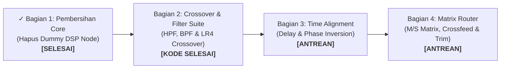
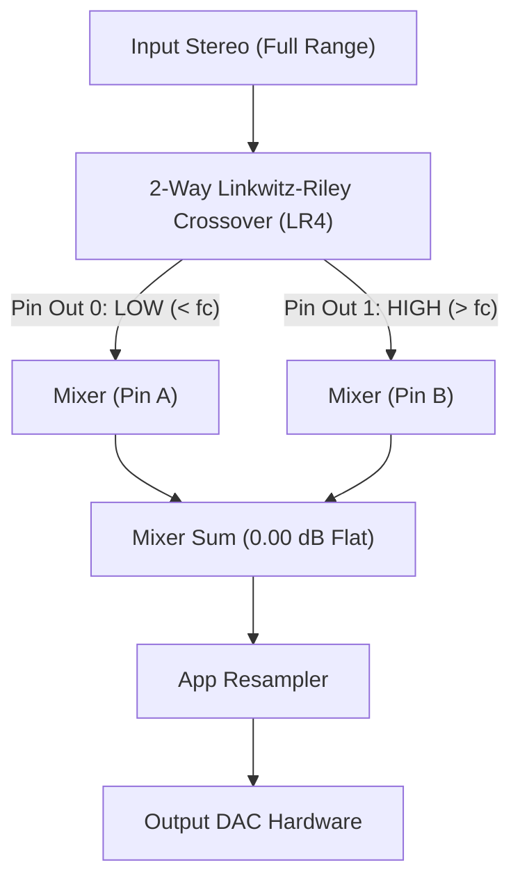
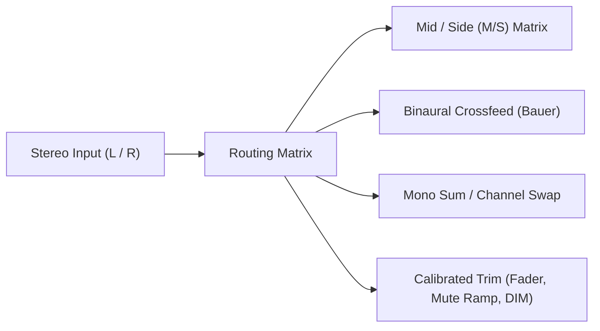

# Roadmap Arsitektur DSP Modular & Signal Chain Studio

Dokumen ini merangkum peta jalan (*roadmap*) pengembangan arsitektur patchbay modular Lunula Audio Player. Seluruh perancangan berpedoman mutlak pada [`principle.md`](principle.md): **"Lunula is honest audio player, no gimmick allowed"** — tidak ada jargon palsu, tidak ada klaim hardware semu, dan seluruh alur sinyal mencerminkan komputasi audio digital yang nyata.

---

## Ringkasan Status Roadmap (Tinggal 3 Bagian Lanjutan)

| Bagian | Modul & Fitur | Status | Catatan Integritas |
| :--- | :--- | :---: | :--- |
| **Bagian 1** | Pembersihan Node `DSP ENGINE` & Kabel Default | **SELESAI** | Menghapus dummy node 3, direct cable bit-perfect 1:1. |
| **Bagian 2** | HPF, BPF, LR4 2-Way Crossover, & HUD Telemetri | **KODE SELESAI** | Bebas gimmick hardware, telemetri kontras tinggi, 86 unit test lolos. |
| **Bagian 3** | Time Alignment & Phase Inversion Matrix | **ANTREAN** | Kompensasi jarak dengar akustik & pencegahan comb filtering. |
| **Bagian 4** | Matrix Router (Mid/Side, Crossfeed) & Calibrated Trim | **ANTREAN** | Utilitas mastering M/S decoding & attenuator mikro anti-klik. |

---

## 📌 Bagian 1: Pembersihan Core & Redesain Rantai Default (SELESAI)

> [!NOTE]
> Menghapus ketergantungan pada dummy node `DSP ENGINE` yang sebelumnya hanya merupakan passthrough 0 dB, dan menjadikan patchbay murni *Directed Acyclic Graph* (DAG).

### Sasaran & Pencapaian
- [x] **Pembersihan Default Wiring**:
  - Node dummy `DSP ENGINE` dihapus dari rantai bawaan awal.
  - Alur default mengalir langsung:
    $$\text{FILE SOURCE} \longrightarrow \text{RAM BUFFER} \longrightarrow \text{APP RESAMPLER} \longrightarrow \text{OUTPUT DAC}$$
  - Sinyal pada mode Bit-Perfect mengalir murni 1:1 tanpa overhead atau colorasi tersembunyi.
- [x] **Pembaruan Teks & Banner Status**:
  - Menghapus penyebutan "DSP Engine" dan hardcode "10-Band EQ" pada banner utama.
  - Banner kini jujur mendeteksi apakah ada modul efek modular yang tersambung (`✓ Rantai Modular Aktif (...)`) atau murni `Direct Passthrough`.

---

## 📌 Bagian 2: Crossover & Filtering Suite (KODE & TEST SELESAI)

> [!IMPORTANT]
> Menyediakan filter pemotongan frekuensi presisi tinggi dan pemisah pita frekuensi 2-arah fase-koheren (*Linkwitz-Riley 4th Order*) tanpa jargon audiophile palsu.

### Sasaran & Pencapaian
- [x] **Modular High-Pass Filter (HPF)**:
  - Koefisien Biquad presisi ganda `f64` stabil hingga 20 Hz.
  - Cutoff variabel ($20\text{ Hz} - 20{,}000\text{ Hz}$), pilihan slope curam ($-12$, $-24$, $-48\text{ dB/oct}$), dan Fringe $Q$ resonansi ($0.20 - 4.00$).
- [x] **Modular Band-Pass Filter (BPF)**:
  - Respons puncak tepat $0.0\text{ dB}$ pada frekuensi tengah (*zero digital clipping*).
  - Center frequency ($50\text{ Hz} - 16\text{ kHz}$), Bandwidth $Q$ ($0.30 - 5.00$), dan slope ($\pm 12$, $\pm 24\text{ dB/oct}$).
- [x] **2-Way Linkwitz-Riley Crossover (`LR4`, 24 dB/oct)**:
  - Filter kaskade Butterworth orde-4 dengan redaman $-6.02\text{ dB}$ pada titik potong ($f_c$).
  - **Flat Summation**: Penjumlahan sinyal Low + High menghasilkan respons magnitudo flat sempurna ($1.0000$ / $0.00\text{ dBFS}$) tanpa pembatalan fase (*phase cancellation*).
  - Output independen ganda: Pin 0 (`LOW`) dan Pin 1 (`HIGH`).
- [x] **Kepatuhan Prinsip Kejujuran Audio ([`principle.md`](principle.md))**:
  - Menghapus seluruh istilah fiktif dari tutorial (`tutorial.rs`): tidak ada klaim *"speaker treble"*, *"speaker bass"*, *"bi-amping"*, atau *"subwoofer direct LFE"*.
  - Panduan tutorial dengan jujur menegaskan: Output DAC hanya memiliki 1 kabel input hardware, sehingga penggunaan Crossover untuk mendengarkan LOW & HIGH secara bersamaan **wajib disatukan melalui modul Mixer**.
- [x] **HUD Telemetri Kontras Tinggi**:
  - Memperbaiki masalah teks gelap yang tidak terbaca pada panel filter di `advance_studio.rs`.
  - Menggunakan tipografi putih cerah (`#F1F5F9`), tombol preset tegas, dan penambahan badge telemetri ganda di kartu kanvas (`[📡 Cutoff Hz]` & `[📐 Slope dB • Q]`).
- [x] **Pendeteksian Lirik `.lrc` Robust**:
  - Pencarian *case-insensitive*, dukungan format file `.flac.lrc`, multi-encoding (UTF-8, UTF-16 LE/BE dengan BOM), dan timestamp desimal koma (`[01:10,50]`).
- [x] **Verifikasi Pengujian**: 86 unit test di `cargo test --lib` lulus tanpa error.

---

## 📌 Bagian 3: Time Alignment & Phase Alignment Suite (ANTREAN BERIKUTNYA)

> [!TIP]
> Mengoreksi ketidakseimbangan jarak fisik headphone/speaker terhadap telinga pendengar (*acoustic center*) secara matematis untuk mencegah *comb filtering*.

### Sasaran & Pekerjaan
1. **DSP Delay Line Engine**:
   - Menambahkan `NodeType::TimeAlignment` dan `TimeAlignmentEffect`.
   - Menggunakan circular ring-buffer stereo independen (kanal Left & Right terpisah).
   - Rentang delay: $0.0\text{ ms} - 25.0\text{ ms}$ (akurasi per-sampel $\approx 0.02\text{ ms}$ pada $44.1\text{ kHz}$).
2. **Phase Inversion Matrix**:
   - Saklar pembalik polaritas matematis ($\varnothing\ 180^\circ$) per kanal ($s \leftarrow -s$).
   - Sangat penting untuk menyelaraskan polaritas saat menggabungkan sinyal paralel atau mengoreksi rekaman terbalik fasa.
3. **Inspector & Visualisator Akustik**:
   - Tampilan UI di Telemetry Desk dengan pilihan satuan jarak: Milidetik ($\text{ms}$), Sentimeter ($\text{cm}$), atau Inci ($\text{in}$).

### Kriteria Verifikasi
- [ ] Uji sinyal sinus $1\text{ kHz}$: delay $1.0\text{ ms}$ menggeser buffer tepat sebanyak $\text{sample\_rate} \times 0.001$ sampel.
- [ ] Uji phase inversion: penjumlahan sinyal stereo mono yang dibalik $180^\circ$ menghasilkan hening mutlak ($-\infty\text{ dBFS}$).

---

## 📌 Bagian 4: Routing Matrix Mixer & Level Utility (ANTREAN AKHIR)

> [!IMPORTANT]
> Memberikan manipulasi sinyal stereo tingkat studio profesional (Mid/Side processing, Binaural Crossfeed) serta attenuator mikro yang akurat.

### Sasaran & Pekerjaan
1. **Multi-Mode Routing Matrix (`NodeType::MatrixRouter`)**:
   - **Mid/Side Encoder & Decoder**:
     $$\text{Mid} = \frac{L + R}{\sqrt{2}}, \quad \text{Side} = \frac{L - R}{\sqrt{2}}$$
     Memungkinkan pemrosesan vokal tengah (Mid) tanpa mengubah instrumen stereo di pinggir (Side).
   - **Binaural Crossfeed (Bauer / Meier)**:
     Menyaring sedikit sinyal silang L $\leftrightarrow$ R dengan low-pass filter ($\approx 700\text{ Hz}$) dan delay mikro ($\approx 0.3\text{ ms}$) guna mengemulasi panggung akustik alami saat menggunakan headphone.
   - **Mono Sum & Channel Swap**:
     Pengecekan kompatibilitas mono ($L+R$) dan pertukaran kanal ($L \leftrightarrow R$).
2. **Precision Calibrated Trim (`NodeType::CalibratedTrim`)**:
   - Fader gain presisi bertingkat $0.1\text{ dB}$ (rentang $-24.0\text{ dB}$ s/d $+12.0\text{ dB}$).
   - Tombol **MUTE** mikro dengan kurva ramp anti-klik ($5\text{ ms}$) untuk melindungi telinga dan transduser.
   - Tombol **DIM ($-20\text{ dB}$)** untuk referensi cepat level volume dengar aman.

### Kriteria Verifikasi
- [ ] Encode M/S kemudian langsung di-decode kembali menghasilkan audio yang bit-perfect identik dengan input.
- [ ] Tombol Mute dan DIM bekerja bebas dari bunyi letupan (*click/pop-free*).

